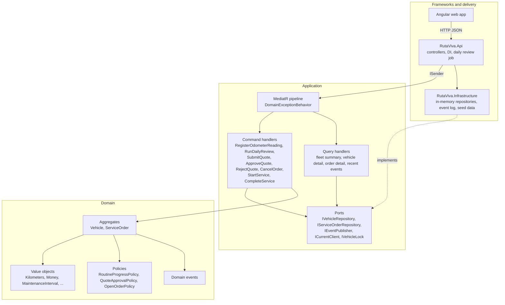
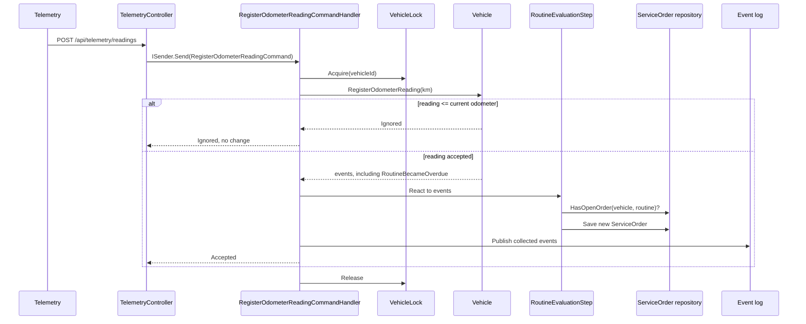

# RutaViva — Technical architecture

How the solution is built. The business rules are in `domain-model.md` and the screens in `ux-proposal.md`. This document explains the structure that holds them and the reasons behind each choice.

## Summary

| Concern | Choice |
| --- | --- |
| Backend | .NET 8, ASP.NET Core controllers |
| Architecture | Clean architecture: Domain, Application, Infrastructure, API |
| Application style | CQRS: commands and queries dispatched through MediatR 12 (Apache 2.0) |
| Frontend | Angular 18, standalone components, signals |
| Persistence | In memory, behind repository ports |
| Events | Collected by aggregates, published in process after each save |
| Daily review | `BackgroundService` in the API host, plus an endpoint to run it on demand |
| Time | `TimeProvider` injected. The domain only receives `DateOnly` |
| Tests | xUnit for domain and application, `WebApplicationFactory` for the API |
| Run | `docker compose up`, or `dotnet run` plus `npm start` |

## Clean architecture

Dependencies point inward. The domain knows nothing about HTTP, storage, or time sources. The outer layers implement interfaces the inner layers declare.



| Layer | Project | Depends on | Owns |
| --- | --- | --- | --- |
| Domain | `RutaViva.Domain` | Nothing | Entities, value objects, policies, domain events, domain exceptions |
| Application | `RutaViva.Application` | Domain, MediatR | Commands, queries, their handlers, pipeline behaviors, ports, DTOs |
| Infrastructure | `RutaViva.Infrastructure` | Application, Domain | Repository adapters, event log, vehicle lock, seed data |
| API | `RutaViva.Api` | Application, Infrastructure | Controllers, request contracts, error mapping, DI wiring, background job |

`RutaViva.Api` references Infrastructure only to register it in the container. Controllers send a command or a query through `ISender`. They never call a repository or a handler directly.

## Solution layout

```text
DEVELOPER I/                  workspace root
  docs/                        architecture, domain model, UX, challenge statement
  rutaviva-api/                .NET 8 solution and OpenSpec change
    RutaViva.sln
    openspec/
    src/
    RutaViva.Domain/         no project references
      Vehicles/          Vehicle, MaintenanceRoutine, ServiceBaseline
        Events/          one file per domain event
      ServiceOrders/     ServiceOrder, Quote, Cancellation, ApprovalSource
        Events/          one file per domain event
      Shared/            Kilometers, Money, MaintenanceInterval, ServiceCompletion
        Identifiers/     VehicleId, RoutineId, ServiceOrderId, WorkshopId, FleetClientId
      Policies/          RoutineProgressPolicy, QuoteApprovalPolicy, OpenOrderPolicy, status enums
    RutaViva.Application/
      Abstractions/Messaging/  ICommand, IQuery, ICommandHandler, IQueryHandler
      Behaviors/               DomainExceptionBehavior
      Commands/                one folder per command: <Name>Command + <Name>CommandHandler
        RegisterOdometerReading/, RunDailyReview/, SubmitQuote/, ApproveQuote/,
        RejectQuote/, CancelOrder/, StartService/, CompleteService/
        Shared/                RoutineEvaluationStep, OrderWriteAccess, DomainEventFlusher
      Queries/                 one folder per query: <Name>Query + handler + DTOs
        GetFleetSummary/, GetVehicleDetail/, GetOrderDetail/, GetRecentEvents/
      Errors/                  ValidationException, NotFoundException, ConflictException
      Ports/                   one file per port; RecordedEvent beside the event log
    RutaViva.Infrastructure/
      Persistence/       InMemoryVehicleRepository, InMemoryServiceOrderRepository
      Events/            InMemoryEventLog
      Concurrency/       VehicleLock
      Time/              BogotaClock
      Clients/           CurrentClient
      Workshops/         WorkshopDirectory
      Seed/              DemoFleet, FleetSeeder
    RutaViva.Api/        references Application and Infrastructure, not Domain
      Controllers/       Fleet, Vehicles, Orders, Telemetry, WorkshopOrders, System, Health
      Contracts/         request bodies
      OpenApi/           Swagger document, tag descriptions
      Jobs/              DailyMaintenanceReviewJob, FleetSeedHostedService
      Errors/            ApiExceptionHandler
    tests/
      RutaViva.Domain.Tests/
      RutaViva.Application.Tests/
      RutaViva.Api.Tests/
  rutaviva-webui/              Angular app (not started; out of the current change)
  docker-compose.yml           planned, see A15
  README.md                    planned, see A15
```

The Application project splits writes and reads first, then one folder per command or query. A reviewer finds a request, its handler, and its DTOs side by side.

## Main flows

### Reading that makes a routine overdue



The daily review uses the same `RoutineEvaluationStep`. Distance and time triggers open orders in exactly one place.

### Completing a service

`CompleteServiceCommandHandler` loads the order and the vehicle under the same vehicle lock. It calls `ServiceOrder.Complete`, then `Vehicle.RestartRoutine` with the reported kilometers and date. It saves both and publishes `ServiceCompleted`.

## Decisions

### A1. Clean architecture with four projects

Four projects make the dependency rule visible in the solution itself. A domain class cannot reference ASP.NET Core because the project does not reference it.

Alternative considered: one project with folders. Simpler, but nothing stops a domain class from depending on infrastructure, and the challenge asks reviewers to see the structure.

### A2. CQRS with MediatR

Every write is a command (`ICommand` or `ICommand<T>`) and every read is a query (`IQuery<T>`). Each has exactly one handler. Command handlers load aggregates, call the domain, save, and publish events. Query handlers only read and map to DTOs. They never change state.

MediatR dispatches both. Its pipeline holds the cross-cutting rule that the API must not know the domain: `DomainExceptionBehavior` turns any `DomainException` into a `ConflictException`, which the API maps to 409. Adding logging or validation later means adding another behavior, not editing every handler.

MediatR is pinned to 12.4.1, the last Apache 2.0 release. Version 13 and later need a commercial license key.

Reads and writes share the in-memory repositories. A separate read store would be over-engineering at this size. The query side is where it would plug in.

Alternative considered: plain use-case classes injected into the endpoints. Fewer moving parts, but each handler had to wrap domain errors itself, and nothing in the code separated reads from writes.

### A3. Controllers grouped by actor

Controllers are thin. Each action builds one command or query from the route and body, sends it through `ISender`, and returns the result. Request bodies live in `Contracts/`, so the HTTP shape can change without changing a command.

| Actor | Controller | Routes | Requests |
| --- | --- | --- | --- |
| Client | `FleetController`, `VehiclesController`, `OrdersController` | `GET /api/fleet`, `GET /api/vehicles/{id}`, `GET /api/orders/{id}`, `POST /api/orders/{id}/approve`, `/reject`, `/cancel` | Queries, `ApproveQuoteCommand`, `RejectQuoteCommand`, `CancelOrderCommand` |
| Telemetry | `TelemetryController` | `POST /api/telemetry/readings` | `RegisterOdometerReadingCommand` |
| Workshop | `WorkshopOrdersController` | `POST /api/workshop/orders/{id}/quote`, `/start`, `/complete` | `SubmitQuoteCommand`, `StartServiceCommand`, `CompleteServiceCommand` |
| System | `SystemController`, `HealthController` | `POST /api/system/daily-review`, `GET /api/system/events`, `GET /health` | `RunDailyReviewCommand`, `GetRecentEventsQuery` |

Alternative considered: Minimal APIs. They work as well. Controllers give one class per actor, attribute routing, and the familiar model-binding errors, which a reviewer recognizes quickly.

### A4. Fixed current client instead of authentication

`ICurrentClient` returns the seeded client id. Client queries and commands filter by it. Replacing it with a claims-based implementation is the only change real authentication would need.

### A5. In-memory persistence behind repository ports

Repositories are interfaces in Application. The adapters in Infrastructure keep aggregates in `ConcurrentDictionary` instances. Swapping in a database adds a new adapter. Use cases and domain stay as they are.

Repositories return and store whole aggregates. Query handlers read the same repositories and map to records for the screens. A separate read model would be over-engineering for in-memory data.

### A6. One lock per vehicle for writes

Every write that touches a vehicle or its orders runs under that vehicle's lock: readings, the daily review for that vehicle, and every order command.

This keeps the one-open-order rule true when two readings for the same vehicle arrive at the same time. It also serializes duplicate and out-of-order telemetry, so the "ignore lower readings" rule is evaluated against the latest saved odometer.

The lock is a port (`IVehicleLock`) implemented with one `SemaphoreSlim` per vehicle id. A database version would replace it with optimistic concurrency or a unique index on open orders.

### A7. Domain events collected by aggregates, published after save

Aggregates add events to an internal list. The command handler saves, then `DomainEventFlusher` publishes the list through `IEventPublisher` and clears it. These are not MediatR notifications. Publishing stays one explicit step after save.

Reactions that change state, such as opening an order on `RoutineBecameOverdue`, are explicit calls in `RoutineEvaluationStep`. They are not hidden event handlers. The publisher writes events to the in-memory event log that the simulation panel shows. Sending real notifications is out of scope.

### A8. Time comes from `TimeProvider`

The domain receives `DateOnly` and `DateTimeOffset` as arguments. It never reads the clock.

The application computes "today" from `TimeProvider` in `America/Bogota` (UTC-5, no daylight saving). Tests use a fake `TimeProvider`. The demo can pass any date to `POST /api/system/daily-review`.

### A9. Daily review as a hosted job, plus an on-demand endpoint

`DailyMaintenanceReviewJob` is a `BackgroundService` with a `PeriodicTimer`. It sends `RunDailyReviewCommand` for today once per day.

The same command runs from `POST /api/system/daily-review`. That is how the reviewer tests calendar-month rules without waiting.

Alternative considered: an Azure Function or a separate worker. It would mean a second deployable for one call per day, and the in-memory state lives in the API process.

### A10. Error mapping with problem details

| Situation | HTTP | Body |
| --- | --- | --- |
| Invalid input, for example negative kilometers or a missing completion date | 400 | Validation problem details |
| Vehicle or order not found, or not owned by the current client | 404 | Problem details |
| Transition not allowed, for example `Start` on a `Quoted` order | 409 | Problem details with the current status |
| Reading equal to or lower than the odometer | 200 | `{ "result": "Ignored" }` |

An ignored reading is a 200, not an error. The statement says it is ignored without error.

Messages shown to the client are in Spanish. Codes and logs are in English.

### A11. Angular frontend organized by feature

- Standalone components. No `NgModule`.
- Features: `fleet`, `vehicle`, `order`, `simulation`. Each has its page component and an API service.
- State: Angular signals in each feature. After any command, the page reloads the affected data from the API. No global store library.
- Styling: plain CSS with tokens taken from the Penpot mockup (Inter, the status colors, spacing). The status chip, button, and card are shared components.
- Status names map from the API enum to Spanish labels in one place.

Doggie UI is not used because the repository must be public and the component library is private.

### A12. API contract published with OpenAPI

The API exposes Swagger UI in development at `/swagger`. Controller XML comments and the tag descriptions are part of the OpenAPI document. The Angular app types its requests with TypeScript interfaces that mirror the API records. Generating the client was considered, but at this size it adds build steps for little gain.

### A13. Seed data on startup

Infrastructure seeds one client, one workshop, three vehicles, and their routines when the app starts, using the cases in `ux-proposal.md`. Every demo flow is reachable from a fresh start.

### A14. Testing by tier

| Tier | Project | Covers |
| --- | --- | --- |
| Strict, test first | `RutaViva.Domain.Tests` | Value objects, `RoutineProgressPolicy` (10%, exact limits, calendar months, whichever comes first), `Vehicle` readings, `MaintenanceRoutine` transitions, `ServiceOrder` state machine, 1,500,000 COP boundary |
| Contract | `RutaViva.Application.Tests` | Commands and queries sent through `ISender` with the real pipeline and in-memory adapters: one open order, ignored readings, complete restarts the routine, reject leaves the routine overdue |
| Smoke | `RutaViva.Api.Tests` | A few end-to-end requests through `WebApplicationFactory`: happy path, 404, 409, ignored reading |

Tests use xUnit with its built-in assertions. Test names describe the business rule they check.

### A15. One command to run

`docker compose up` starts the API and the Angular app. The README also lists the `dotnet` and `npm` commands for running without Docker.

## Out of this architecture

- A real database and migrations.
- Authentication and authorization.
- A message broker. Events stay in process.
- Sending notifications.
- Deployment pipelines beyond a CI workflow that builds and tests.

Each one has a port or an adapter where it would plug in.
