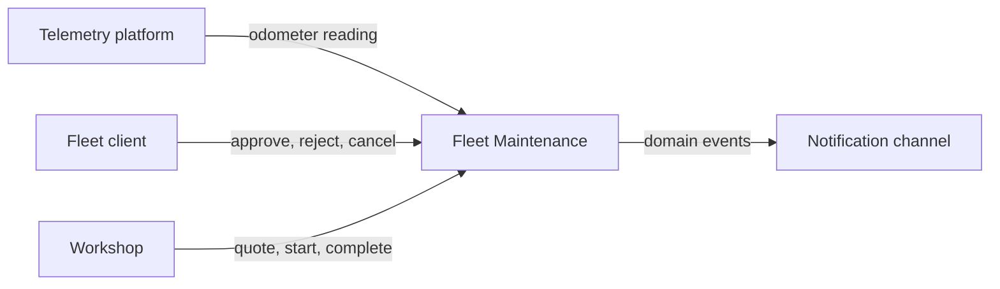
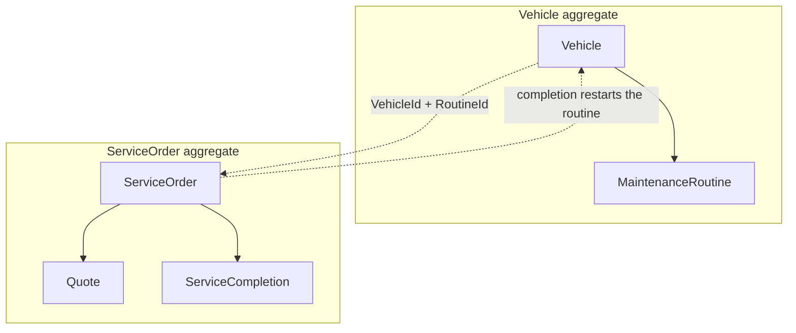
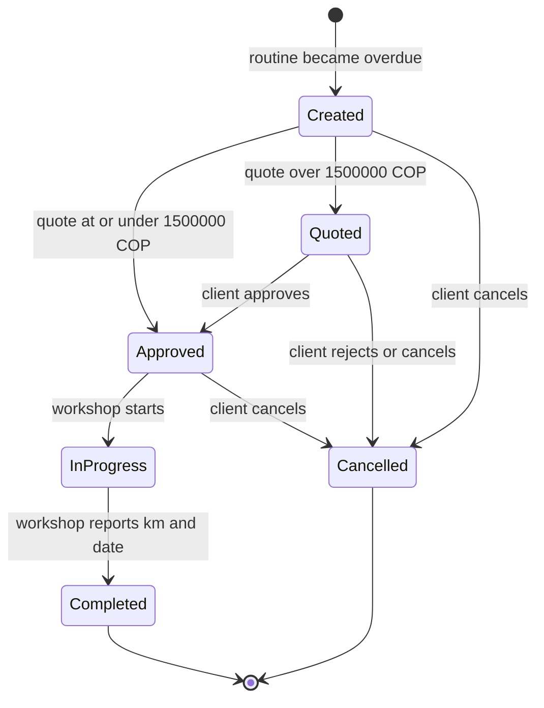

# RutaViva — Domain Model (DDD)

Preventive maintenance for a vehicle fleet. This document is the source of truth for the domain layer. Code should follow these names and rules.

One bounded context: **Fleet Maintenance**. Telemetry and notifications are outside it. They enter and leave through commands and domain events.

## Ubiquitous language

| Term in the statement (Spanish) | Model name | Meaning |
| --- | --- | --- |
| Vehículo | `Vehicle` | A tracked unit with one odometer, one assigned workshop, and its own routines. |
| Rutina | `MaintenanceRoutine` | A repeating service on a vehicle (oil, brakes, tires). |
| Intervalo | `MaintenanceInterval` | How often a routine is due: by kilometers, by calendar months, or both. |
| Al día | `UpToDate` | Inside the safe part of the interval. |
| Por vencer | `DueSoon` | 10% or less of the interval remains, and it is not overdue yet. |
| Vencida | `Overdue` | The interval has been reached. |
| Ciclo | Cycle | From the last completed service until the next completion. |
| Lectura de odómetro | Odometer reading | A kilometer value reported by telemetry for a vehicle. |
| Orden de servicio | `ServiceOrder` | Work requested from the workshop for exactly one routine. |
| Abierta | Open order | Any order that is not `Completed` and not `Cancelled`. |
| Cotización | `Quote` | The workshop's price for an order. |
| Taller | `Workshop` | External workshop already assigned to the vehicle. |
| Cliente (jefe de flota) | `FleetClient` | Approves or rejects high quotes and may cancel orders. |
| Línea base del servicio | `ServiceBaseline` | Kilometers and date the current cycle started from. |

## Context map

The notification channel only needs the published event. Delivering email or push is out of scope. Choosing or scheduling a workshop is out of scope: the vehicle already has a workshop.

## Aggregates

Two aggregates. Each changes only inside one transaction, and only through its root.

| Aggregate root | Owns | Why it is its own aggregate |
| --- | --- | --- |
| `Vehicle` | `MaintenanceRoutine` entities, current odometer | The odometer and every routine on that vehicle must change together. A reading evaluates the whole vehicle. |
| `ServiceOrder` | `Quote`, `ServiceCompletion` | Workshop and client drive a long lifecycle. That lifecycle must not lock the vehicle. |

`Workshop` and `FleetClient` are reference data (id and display name). They have no business behavior.

### Cross-aggregate rules

These rules touch both aggregates, so they do not live inside either root. A domain service checks them before the write.

1. **One open order per vehicle and routine.** Before opening an order, `OpenOrderPolicy` loads whether an open order already exists for that `VehicleId` + `RoutineId`. If it does, no second order is created.
2. **Completion restarts the cycle.** `Complete` on the order and `RestartRoutine` on the vehicle happen in one application use case, in that order. The order stores the reported kilometers and date. The vehicle then restarts that routine from those values.
3. **An order is opened only when a routine becomes overdue.** The vehicle raises `RoutineBecameOverdue`. The application opens the order. It does not open another order on later evaluations of the same cycle.

## Entities

Entities have identity and a life cycle. Value objects do not.

### `Vehicle` (aggregate root)

| Field | Type | Notes |
| --- | --- | --- |
| `Id` | `VehicleId` | Identity. |
| `ClientId` | `FleetClientId` | Who receives the due-soon notice and who may approve. |
| `AssignedWorkshopId` | `WorkshopId` | Copied onto each new order. Not chosen at order time. |
| `Odometer` | `Kilometers` | Last accepted reading. Never decreases. |
| `Routines` | collection of `MaintenanceRoutine` | The vehicle's own plan. |

Behavior:

| Method | Effect |
| --- | --- |
| `RegisterOdometerReading(Kilometers reading)` | If `reading` is less than or equal to `Odometer`, return `Ignored` and change nothing. No error. If it is greater, store it and run distance evaluation on every routine. |
| `RunDailyReview(DateOnly today)` | Run time evaluation on every routine. This is the only path that advances time-based status. |
| `RestartRoutine(RoutineId routineId, ServiceCompletion completion)` | Reset that routine's cycle from the reported kilometers and date. If the reported kilometers are greater than `Odometer`, advance `Odometer` to that value. A lower report does not move the odometer backward. |
| `AddRoutine(...)` | Configuration used by seed data. Adds one routine already at `UpToDate`. |

### `MaintenanceRoutine` (entity inside `Vehicle`)

Not a root. It is only changed by `Vehicle`.

| Field | Type | Notes |
| --- | --- | --- |
| `Id` | `RoutineId` | Stable id, referenced by orders. |
| `Name` | string | Example: oil change, brakes, tires. Not a subclass. |
| `Interval` | `MaintenanceInterval` | Fixed for the routine in this challenge. |
| `Baseline` | `ServiceBaseline` | Start of the current cycle. |
| `DistanceStatus` | `DimensionStatus` | Last result of a distance evaluation. |
| `TimeStatus` | `DimensionStatus` | Last result of a daily time evaluation. |
| `Status` | `RoutineStatus` | The worse of the two dimensions. This is what the user sees. |

`DistanceStatus` and `TimeStatus` are stored so the two triggers stay separate. A kilometer reading must not mark a routine overdue just because the calendar date has passed. The daily review does that.

Behavior (called only by `Vehicle`):

| Method | Effect |
| --- | --- |
| `ApplyDistance(Kilometers currentOdometer)` | Recompute `DistanceStatus`. Recombine `Status`. |
| `ApplyTime(DateOnly today)` | Recompute `TimeStatus`. Recombine `Status`. |
| `Restart(ServiceCompletion completion)` | New baseline. Both dimensions and `Status` return to `UpToDate` (or `NotApplicable` when that dimension does not exist). |

Status only moves forward inside a cycle: `UpToDate` → `DueSoon` → `Overdue`, or `UpToDate` → `Overdue` when one evaluation skips the middle. It moves backward only on `Restart`.

### `ServiceOrder` (aggregate root)

| Field | Type | Notes |
| --- | --- | --- |
| `Id` | `ServiceOrderId` | Identity. |
| `VehicleId` | `VehicleId` | Target vehicle. |
| `RoutineId` | `RoutineId` | The single routine this order covers. |
| `RoutineName` | string | Snapshot, so the order still reads clearly later. |
| `WorkshopId` | `WorkshopId` | Snapshot of the vehicle's assigned workshop. |
| `Status` | `ServiceOrderStatus` | See the state machine below. |
| `Quote` | `Quote` or empty | Empty until the workshop submits a price. |
| `Completion` | `ServiceCompletion` or empty | Set only when the workshop completes the work. |
| `Cancellation` | `Cancellation` or empty | Set when the order is rejected or cancelled. |
| `OpenedAt` | `DateTimeOffset` | When the system created it. |

Behavior:

| Method | From | To |
| --- | --- | --- |
| `SubmitQuote(Money amount, DateTimeOffset at)` | `Created` | `Approved` when `amount` is less than or equal to 1,500,000 COP. `Quoted` when it is greater. |
| `Approve()` | `Quoted` | `Approved`. Client decision. Valid only when the quote requires manual approval. |
| `RejectQuote()` | `Quoted` | `Cancelled`, reason `QuoteRejected`. |
| `Cancel()` | `Created`, `Quoted`, or `Approved` | `Cancelled`, reason `CancelledByClient`. |
| `Start()` | `Approved` | `InProgress`. |
| `Complete(ServiceCompletion completion)` | `InProgress` | `Completed`. Kilometers and date are required. |

`IsOpen` is true unless status is `Completed` or `Cancelled`.

An invalid transition throws a domain exception. It does not return a silent failure.

## Value objects

Immutable. Equality is by value. Constructors reject invalid values.

| Value object | Contents | Rules |
| --- | --- | --- |
| `VehicleId`, `RoutineId`, `ServiceOrderId`, `WorkshopId`, `FleetClientId` | `Guid` | Not empty. |
| `Kilometers` | non-negative integer | Compared and subtracted. No fractions. |
| `Money` | non-negative amount in COP | Compared with the approval threshold. |
| `MaintenanceInterval` | optional `Kilometers`, optional period in calendar months | At least one side is present. Each present side is greater than zero. The due date for the time side is `baseline.AddMonths(months)`. |
| `ServiceBaseline` | `Kilometers` + `DateOnly` | Origin of the current cycle. |
| `Quote` | `Money` + `DateTimeOffset` | One quote per order. |
| `ServiceCompletion` | `Kilometers` + `DateOnly` | Values the workshop reports. The cycle restarts from these, not from "today" or the latest telemetry. |
| `Cancellation` | `CancellationReason` + `DateTimeOffset` | Reasons: `QuoteRejected`, `CancelledByClient`. |
| `RoutineStatus` | `UpToDate`, `DueSoon`, `Overdue` | Severity increases in that order. |
| `DimensionStatus` | `NotApplicable`, `UpToDate`, `DueSoon`, `Overdue` | `NotApplicable` is left out of the "worse of" combination. |

### How status is calculated

`RoutineProgressPolicy` is the only place that applies the 10% rule.

For a dimension that exists, define three numbers in the same unit (kilometers or days):

- `total`: the length of the cycle for this dimension.
- `elapsed`: how far the cycle has advanced since the baseline.
- `remaining = total - elapsed`.

Then:

1. If `elapsed >= total`, the dimension is `Overdue`. Reaching the limit exactly is overdue.
2. Else if `remaining * 10 <= total`, the dimension is `DueSoon`.
3. Else the dimension is `UpToDate`.

The integer comparison avoids rounding.

**Kilometers.** `total` is the fixed interval, and `elapsed = odometer - baseline.Kilometers`.

**Time.** `total` is the real length of the cycle, which depends on the calendar. `dueDate = baseline.Date.AddMonths(months)`, `total = dueDate - baseline.Date` in days, `elapsed = today - baseline.Date`, and `remaining = dueDate - today`. A month is 28 to 31 days, so `total` changes from cycle to cycle.

Examples:

- 10,000 km → due soon when 1,000 km or fewer remain, overdue at 10,000 km elapsed.
- 6 months from 1 January 2026 → due date 1 July 2026, `total` = 181 days. Due soon when 18 days or fewer remain (`18 × 10 = 180 <= 181`, `19 × 10 = 190 > 181`), so from 13 June 2026. Overdue on 1 July 2026.
- 1 month from 31 January 2026 → `AddMonths` gives 28 February, `total` = 28 days. Due soon when 2 days or fewer remain, so from 26 February. Overdue on 28 February.

`Status` is the worse applicable dimension. With both sides configured, the one that reaches its limit first wins. A kilometer-only routine keeps `TimeStatus = NotApplicable`. A time-only routine keeps `DistanceStatus = NotApplicable`.

The due-soon notice is raised once per cycle, when `Status` **enters** `DueSoon`. Later evaluations that stay in `DueSoon` do not raise it again. `Restart` begins a new cycle, so the next entry to `DueSoon` can notify again.

If one evaluation jumps from `UpToDate` straight to `Overdue`, the model raises `RoutineBecameOverdue` and does not also raise the due-soon notice. The routine was never observed in `DueSoon`.

## Domain services

Stateless. They hold rules that do not naturally belong to one entity.

| Service | Responsibility |
| --- | --- |
| `RoutineProgressPolicy` | Given a baseline, an interval, the current odometer, and a date, return `DimensionStatus` for the dimension being evaluated. Holds the 10% fraction. |
| `QuoteApprovalPolicy` | Manual approval is required only when the quote is **greater than** 1,500,000 COP. Equal to the threshold is approved automatically. The threshold is a named constant here. |
| `OpenOrderPolicy` | An order may be opened only when the routine just became `Overdue` and no open order exists for that vehicle and routine. |

## Domain events

Named in the past tense. Raised by the aggregate that owns the fact. Handlers publish them; they do not send emails.

| Event | Raised by | When | Main payload |
| --- | --- | --- | --- |
| `OdometerAdvanced` | `Vehicle` | A reading strictly greater than the current odometer was stored. | vehicle id, new kilometers |
| `RoutineBecameDueSoon` | `Vehicle` | Combined status entered `DueSoon`. At most once per cycle. | vehicle id, client id, routine id |
| `RoutineBecameOverdue` | `Vehicle` | Combined status entered `Overdue`. At most once per cycle. | vehicle id, routine id, assigned workshop id |
| `ServiceOrderOpened` | `ServiceOrder` | The system created the order. | order id, vehicle id, routine id, workshop id |
| `QuoteSubmitted` | `ServiceOrder` | The workshop sent a price that waits for the client. | order id, amount |
| `ServiceOrderApproved` | `ServiceOrder` | Auto-approval or client approval. | order id, `Auto` or `ByClient` |
| `ServiceOrderRejected` | `ServiceOrder` | The client rejected the quote. The order is cancelled. | order id |
| `ServiceOrderCancelled` | `ServiceOrder` | The client cancelled before execution. | order id |
| `ServiceStarted` | `ServiceOrder` | The workshop started the work. | order id |
| `ServiceCompleted` | `ServiceOrder` | The workshop reported real kilometers and date. | order id, vehicle id, routine id, completion |

A duplicate or lower reading does not raise an event and does not throw. The use case returns `Ignored` so the telemetry screen can show it.

## Order state machine

After `Cancelled` or `Completed` the order accepts no further commands.

The client cannot cancel once the status is `InProgress`. Rejection exists only from `Quoted`, because an auto-approved order never stops in `Quoted`.

## Application use cases

These are not domain objects. They load roots, call the methods above, and save.

| Actor | Use case | Aggregates touched |
| --- | --- | --- |
| Telemetry | `RegisterOdometerReading` | `Vehicle`. Then open an order if `RoutineBecameOverdue` was raised. |
| System (daily) | `RunDailyMaintenanceReview` | Every `Vehicle`. Same order-opening rule. |
| System | `OpenServiceOrder` | `OpenOrderPolicy`, then new `ServiceOrder`. |
| Workshop | `SubmitQuote`, `StartService`, `CompleteService` | `ServiceOrder`. Complete also calls `Vehicle.RestartRoutine`. |
| Client | `ApproveQuote`, `RejectQuote`, `CancelOrder` | `ServiceOrder` only. |

`RegisterOdometerReading` and `RunDailyMaintenanceReview` share one private step that reacts to `RoutineBecameDueSoon` (publish) and `RoutineBecameOverdue` (open an order). The rule is not copied into both use cases.

## Invariants

**Vehicle**

- The odometer never decreases.
- A reading equal to or lower than the current odometer changes nothing and raises no error.
- Every routine id is unique inside the vehicle.
- A routine's combined status is the worse of its applicable dimensions.
- The due-soon event fires at most once per cycle.
- The overdue event fires at most once per cycle.
- Only `RestartRoutine` starts a new cycle.

**Service order**

- It covers exactly one routine.
- Its workshop is the vehicle's assigned workshop at creation time.
- States move only as in the diagram.
- A quote of 1,500,000 COP or less ends the submit operation in `Approved`.
- A quote above 1,500,000 COP ends the submit operation in `Quoted`.
- `Complete` requires reported kilometers and a date.
- Cancel is refused from `InProgress`, `Completed`, and `Cancelled`.

**Across aggregates**

- At most one open order for the same vehicle and routine.
- Completing an order is the only action that restarts the routine.
- Cancelling an order does not restart the routine and does not open a replacement order. The statement leaves post-cancellation behavior unmodeled. The routine stays `Overdue` until a completion restarts it, which cannot happen on a cancelled order.

## Decisions

| # | Decision | Why |
| --- | --- | --- |
| D1 | Time intervals are calendar months. The due date is `baseline.AddMonths(months)`. The 10% window uses the real cycle length in days, so a month can be 28 to 31 days. | The statement says "6 meses", and a fixed 30-day month would be an approximation. With calendar months, 6 months from 1 January 2026 is 181 days, and the 10% rule still gives the 18 day example. |
| D2 | Distance status changes only when a higher reading is accepted. Time status changes only on the daily review. | The statement assigns each trigger to one dimension. |
| D3 | The daily review recomputes time from the baseline date and today, not by stepping one day at a time. | A missed day is caught on the next run. |
| D4 | Jumping from `UpToDate` to `Overdue` does not emit a due-soon notice. | The notice is defined at the moment the routine becomes due soon. That state was not observed. The order is still created. |
| D5 | A new order is created on the transition to `Overdue`, once per cycle, and only if none is open. | Matches "when it expires, create an order" plus "no more than one open order". |
| D6 | After a cancellation, nothing else is modeled. No replacement order. | The statement says post-cancellation behavior is out of scope. |
| D7 | Automatic approval happens inside `SubmitQuote`. The stored status is `Approved`. | The client never sees an order that no longer needs a decision. The auto path raises `ServiceOrderApproved` with source `Auto`. The manual path raises `QuoteSubmitted` and later `ServiceOrderApproved` with source `ByClient`. |
| D8 | Completion mileage above the current odometer advances the odometer. | That mileage is a real observation. The odometer is still forbidden from decreasing. |
| D9 | The routine baseline uses the workshop's reported kilometers and date, even when the reported kilometers are below the current odometer. | The statement says the routine restarts from the reported values. |
| D10 | There is one quote per order. No re-quote. | Not described in the statement. |
| D11 | Routines are data (`Name` + `Interval`), not subclasses per service type. | Oil, brakes, and tires follow the same rules. |

## Out of the domain model

- Selecting or scheduling the workshop.
- Sending the actual notification (the event is enough).
- Payments and invoices.
- Authentication and roles. The application assigns each use case to an actor; the domain enforces the state machine for every caller.
- A real database. Repositories are ports. Memory is a valid adapter.
- Anything that happens after an order is cancelled.
- Screens. The UI is a separate layer that calls the use cases and reads the same state.

## First code to write from this model

Pure domain, test first, no web framework:

1. `Kilometers`, `Money`, `MaintenanceInterval` — construction and comparison.
2. `RoutineProgressPolicy` — the 10,000 km / 1,000 km case, the 6-month case (181 days, due soon from 13 June 2026), the month-end case (31 January + 1 month = 28 February), exact boundaries, and "whichever comes first".
3. `Vehicle.RegisterOdometerReading` — advance, ignore equals, ignore lower, no error.
4. `MaintenanceRoutine` transitions — due soon once, overdue once, jump straight to overdue, restart clears the cycle.
5. `ServiceOrder` — every legal transition, the 1,500,000 boundary, cancel refused once work has started, complete requires kilometers and date.
6. `OpenOrderPolicy` — second open order is refused.
